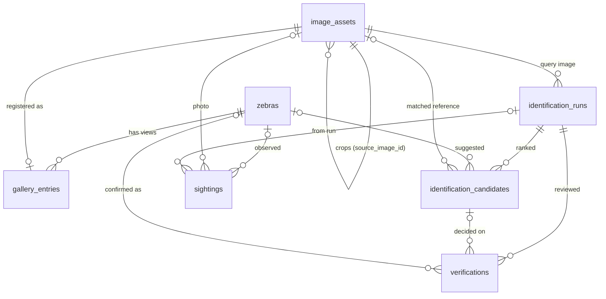

# Phase 2: data model and persistence

Status: schema migrated to Supabase PostgreSQL (initial revision `7f6be5c92a8f`, hardened by `4fa9f00adf31` in Phase 2.5; see `PHASE_2_5_COMPLETION.md`).
Scope: models, migration, Pydantic schemas, repositories and tests. **No API routes, storage upload code or frontend work** (Phase 3+).

## Layout

| Path | Contents |
|---|---|
| `app/database/base.py` | `Base` with constraint naming convention, `UUIDPrimaryKeyMixin`, `TimestampMixin` |
| `app/database/session.py` | lazy engine (pool settings from env), `get_session_factory()`, FastAPI `get_db()`, `session_scope()` |
| `app/models/` | ORM models + enums |
| `app/schemas/` | Pydantic v2 create / update / read schemas |
| `app/repositories/` | CRUD and query functions (flush only; the caller commits) |
| `alembic/versions/7f6be5c92a8f_initial_domain_schema.py` | initial migration (autogenerated, reviewed, plus RLS) |
| `tests/` | integration tests (Supabase, rolled back) + schema unit tests |

## Entities



All primary keys are UUIDs (Python `uuid4`, DB fallback `gen_random_uuid()`). `created_at`/`updated_at` are `timestamptz` and default to `clock_timestamp()`. Unlike `now()`, which is frozen for a whole transaction, this gives rows created in the same transaction a real order.

| Table | Purpose | Key rules |
|---|---|---|
| `zebras` | known individual | unique `code`; `status` active/inactive/deceased; created by curation only, never by inference |
| `image_assets` | metadata for one object in private Storage | `kind` = `query`, `reference` or `crop`; unique (`storage_bucket`, `storage_path`); the path must be bucket-relative, not a URL (DB CHECK); a crop requires `source_image_id` and `crop_bbox` `{x,y,width,height}`, and other kinds must have neither (DB CHECK); `sha256` is lowercase hex |
| `gallery_entries` | registers a reference or crop image as a view of a zebra | unique `image_asset_id` (an image belongs to one zebra); `side` left/right/unknown; `is_active`; the repository rejects `query` images |
| `identification_runs` | one execution of the external recognition pipeline | `status` pending → running → completed or failed; `model_name`, `model_version`, `parameters`, `processing_metadata` (JSONB); `predicted_unknown` is tri-state; failed requires `error_message`; completed requires `completed_at`; `completed_at >= started_at` |
| `identification_candidates` | ranked suggestion of a run | unique (`run_id`, `rank`); `rank >= 1`; `similarity_score` is a finite double; `zebra_id` **or** `external_label` must be set; optional `matched_reference_image_id`; `evidence` JSONB |
| `verifications` | human decision (append-only history; the latest row wins) | `confirmed` needs a candidate and a zebra; `rejected` needs a candidate and no zebra; `unknown` has neither (DB CHECK). A composite FK (`candidate_id`, `run_id`) guarantees the candidate belongs to that run |
| `sightings` | field observation | `zebra_id` nullable (unidentified individual); lat/lon must be given together and within range |

### Unknown identities

There are two independent paths, and neither creates a `Zebra`:
1. **ML label not registered.** The candidate stores `zebra_id = NULL` and keeps the raw label in `external_label`. Such a candidate cannot be `confirmed` until a curator registers the zebra.
2. **Reviewer says "not in gallery / undecidable".** The reviewer records a `Verification(decision='unknown')`, with no candidate and no zebra.

`identification_runs.predicted_unknown` mirrors the engine's `unknown` field. It is `NULL` when no validated threshold was applied, which is the current default in `identify_zebra`.

### Deletion policies

| FK | On delete | Why |
|---|---|---|
| `gallery_entries.zebra_id` | CASCADE | gallery links are meaningless without the zebra |
| `gallery_entries.image_asset_id` | RESTRICT | deregister an image before deleting it |
| `image_assets.source_image_id` | RESTRICT | crops keep their lineage |
| `identification_runs.query_image_id` | RESTRICT | runs are research records |
| `identification_candidates.run_id` | CASCADE | candidates belong to their run |
| `identification_candidates.zebra_id` | RESTRICT | history must not silently lose identities |
| `identification_candidates.matched_reference_image_id` | SET NULL | the reference image may be retired |
| `verifications.run_id` / `candidate_id` / `zebra_id` | RESTRICT | human decisions are audit records |
| `sightings.zebra_id` | RESTRICT | retire zebras via `status`, not delete |
| `sightings.image_asset_id`, `sightings.identification_run_id` | SET NULL | the observation outlives its photo or run |

The ORM uses `passive_deletes="all"` on every RESTRICT relationship. Without it, SQLAlchemy NULLs child FKs before deleting the parent and bypasses RESTRICT; the tests caught this.

`delete_image_asset()` returns the storage path so the caller can delete the Storage object **after** the DB commit.

### Supabase security

- Every table, including `alembic_version`, has **RLS enabled with no policies**. The Supabase REST API (anon/authenticated keys) therefore returns no rows. The backend connects as the table owner through `DATABASE_URL` and bypasses RLS. Add explicit policies only if the frontend must ever query tables directly.
- The database stores Storage paths only: no image bytes, URLs, signed URLs, embeddings or checkpoints.
- The service-role key and `DATABASE_URL` stay in `backend/.env`. The frontend has neither.

## Repositories

Every repository function takes a `Session`, calls `flush()` and never commits. Domain violations raise `NotFoundError` or `DomainRuleError`; database constraint violations surface as `sqlalchemy.exc.IntegrityError`.

| Module | Functions |
|---|---|
| `zebras` | `create_zebra`, `get_zebra`, `get_zebra_by_code`, `list_zebras(status, search)`, `update_zebra`, `delete_zebra`, `resolve_labels` |
| `images` | `create_image_asset` (checks crop box against source size), `get_image_asset`, `get_by_storage_path`, `find_by_sha256`, `list_image_assets(kind)`, `list_crops`, `update_image_asset`, `delete_image_asset` |
| `gallery` | `register_gallery_entry`, `get_gallery_entry`, `list_gallery_for_zebra`, `list_active_gallery`, `update_gallery_entry`, `deactivate_gallery_entry`, `delete_gallery_entry`, `is_gallery_image_of` |
| `identifications` | `create_run` (query/crop images only), `get_run`, `list_runs`, `mark_running`, `complete_run`, `fail_run`, `list_candidates`, `top_candidate`, `list_candidate_runs_for_zebra`, `delete_run` |
| `verifications` | `create_verification`, `list_verifications`, `latest_verification`, `list_confirmed_for_zebra` |
| `sightings` | `create_sighting`, `get_sighting`, `list_sightings(zebra_id, unidentified_only, since, until)`, `update_sighting`, `delete_sighting` |

## Integration with the Member 1/2 engine (explicit assumptions)

Source of truth inspected: `stripecode-ai` `integration/backend.py::analyze_zebra` and `member1_dhanushya/recognition/engine.py::identify_zebra` (main at `c962964`).

1. **No `ZebraDetection` table.** The engine has no detector. `analyze_zebra(region=(x,y,w,h))` takes a manually reviewed box. Regions are modelled as `ImageAsset(kind='crop', source_image_id, crop_bbox)`, using the same `(x, y, width, height)` order. Add a detection table only when a real detector with a defined output exists.
2. **Gallery labels.** `build_gallery(images, identities)` takes string identities. *Assumption:* the caller labels each reference with `str(zebra.id)` (or `zebra.code`). `resolve_labels()` maps returned labels back to zebras; unmatched labels become `external_label`.
3. **Matched reference.** `identify_zebra` returns identity-level scores (the max over that identity's references) and **does not say which reference image matched**. `matched_reference_image_id` is therefore optional. When supplied, it must be a gallery image of the candidate zebra (checked in `complete_run`).
4. **Scores.** These are cosine similarities, not probabilities (`score_type` stores the engine's string). No threshold or calibration is applied here.
5. **Raw output.** The ML JSON contract is not final, so `complete_run` stores the engine's JSON-safe metadata verbatim in `processing_metadata` (e.g. `margin`, `unknown`, `seconds`, `vision_metadata`, `inference_metadata`), and per-candidate extras in `evidence`. NumPy arrays (crops, simulated images, identity maps) must be converted or uploaded to Storage by the caller; they are not stored in the database.
6. **Model version.** `model_version` should hold the engine's `model_id` (pinned checkpoint identifier). Nothing here downloads or loads a model.
7. **Embeddings** stay owned by the recognition engine (its NPZ cache). There is no embedding table, so no duplicate retrieval engine exists.

## Unresolved

- How the final ML contract maps reference images to sample IDs (needed to fill `matched_reference_image_id` automatically).
- Whether Nisan's `member3_venu` schema on `stripecode-ai/main` (`zebras`, `zebra_images`, `sightings`, `identifications`, `audit_logs`, per-user `owner_id`) or this schema becomes canonical. The two use overlapping table names (`zebras`, `sightings`) and **must not both be migrated into the same database**.
- Multi-user ownership/auth: no `owner_id` yet. `uploaded_by`, `requested_by`, `registered_by` and `verified_by` are free-text until auth lands.
- Bucket limits: `zebra_images` has no MIME/size limit configured in Supabase.
- Whether one image may legitimately serve two zebras (e.g. herd photos). Today the answer is no: use a crop per animal.

## Commands

```bash
cd backend
.venv/bin/pip install -r requirements-dev.txt
.venv/bin/alembic upgrade head        # apply migrations (never create tables in the dashboard)
.venv/bin/alembic check               # verify models == database
.venv/bin/alembic revision --autogenerate -m "..."   # new migration; always review before upgrade
.venv/bin/pytest -q                   # runs against DATABASE_URL inside rolled-back transactions
```
